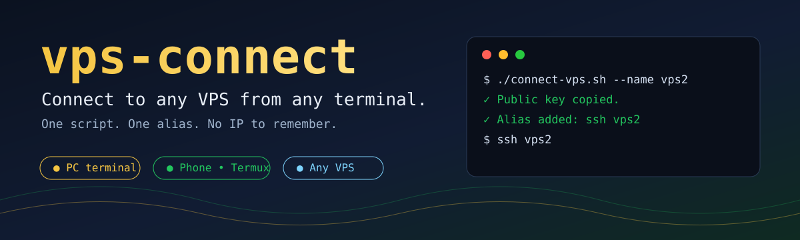
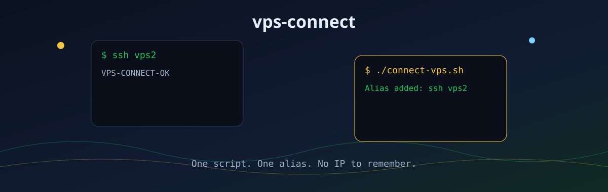
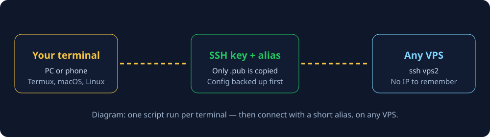
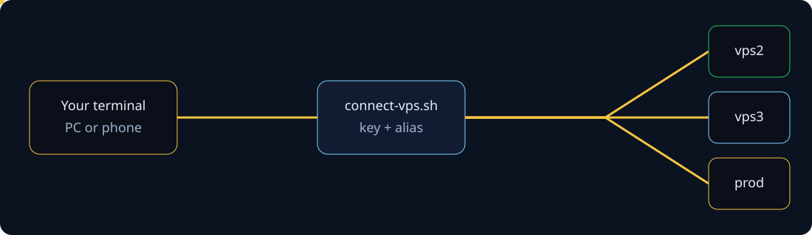
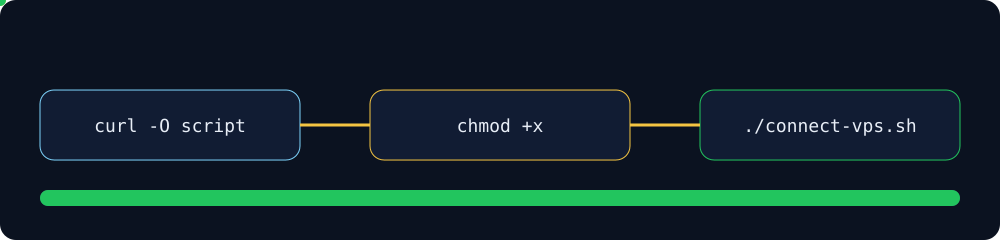
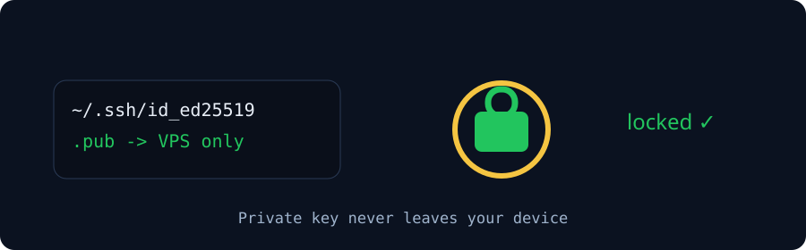
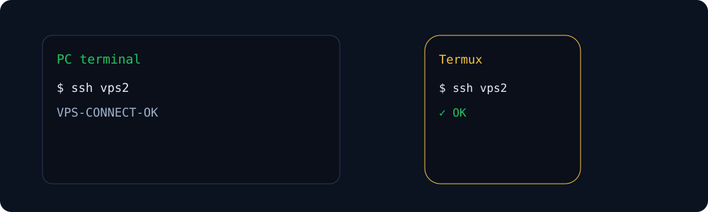

<div align="center">







# vps-connect

### Connect to any VPS from any terminal.

**One script. One alias. No IP to remember.**

[](LICENSE)
[](connect-vps.sh)
[](connect-vps.ps1)
[](connect-vps.sh)
[](#pc--phone)

</div>


## What it is

`vps-connect` is a small, standalone script — **not a web panel, not a service, not a product server**. There are two versions with the same behaviour: `connect-vps.sh` (Bash) and `connect-vps.ps1` (PowerShell, for Windows).

Run it once per terminal, for each VPS you want to reach. It sets up an SSH key and a short alias, so afterwards you connect with just:

```bash
ssh vps2
```

It works on a PC terminal and on a phone terminal (for example Termux), because it uses `$HOME/.ssh` and only standard OpenSSH tools. There is nothing to host, nothing to log into, and no server to run.








## Quick start

Download the script, make it executable, run it:

```bash
curl -O https://raw.githubusercontent.com/mymyanmarland/vps-connect/main/connect-vps.sh
chmod +x connect-vps.sh
./connect-vps.sh --name vps2 --host <VPS-IP>
```




Replace `<VPS-IP>` with your VPS IP or hostname, and `vps2` with any short alias you like (`vps`, `vps3`, `prod`, … — letters, digits, `-` and `_` only).

Then, any time, from that terminal:

```bash
ssh vps2
```

### PowerShell version (Windows)

```powershell
Invoke-WebRequest -Uri https://raw.githubusercontent.com/mymyanmarland/vps-connect/main/connect-vps.ps1 -OutFile connect-vps.ps1
.\connect-vps.ps1 -Name vps2 -Host <VPS-IP>
```

If PowerShell blocks the script, unblock just this file (`Unblock-File .\connect-vps.ps1`) and run it again, or run it once without changing any policy: `powershell -ExecutionPolicy Bypass -File .\connect-vps.ps1 -Name vps2 -Host <VPS-IP>`. See the full PowerShell notes in [connect-vps.ps1](connect-vps.ps1) and on the website's PowerShell and Windows tabs. A `.sh` file does not run in PowerShell or CMD, and a `.ps1` file does not run in CMD.


## Usage

### With arguments (recommended)

```bash
./connect-vps.sh --name vps2 --host <VPS-IP>
./connect-vps.sh --name vps2 --host <VPS-IP> --user ubuntu --port 2222
```

### Interactive (prompts for alias and host)

```bash
./connect-vps.sh
```

You will see:

```text
VPS alias (e.g. vps2):
VPS IP or hostname:
```

### Dry run — see everything, change nothing

```bash
./connect-vps.sh --dry-run --name vps2 --host <VPS-IP>
```

Dry run contacts no VPS, generates no key, and edits no file. It is the safe way to try the script first.


### Help

```bash
./connect-vps.sh --help
```


## What it does, in order

1. **Key** — Reuses your existing `~/.ssh/id_ed25519` key, or generates an ed25519 key if none exists. It never overwrites an existing key.
2. **Backup** — Backs up `~/.ssh/config` to `~/.ssh/config.bak-<date>-<pid>` if it exists.
3. **Alias** — Adds (or replaces, in place) a `Host` block:
   ```text
   Host vps2
       HostName <VPS-IP>
       User root
       Port 22
       IdentityFile ~/.ssh/id_ed25519
   ```
   All other `Host` entries are preserved. A second run with the same alias does **not** duplicate the block — it replaces it.
4. **Copy key** — Copies **only the public key** (`.pub`) to the VPS with `ssh-copy-id` (or a plain `ssh` fallback if `ssh-copy-id` is missing). This is the only first-time step that may ask for the VPS password.
5. **Test** — Tests the alias with `ssh vps2 'echo VPS-CONNECT-OK'` and reports success or failure plainly.




Repeat for every new VPS: change only `--name` and `--host`. Repeat on every terminal you want to use: each terminal gets its own key, and the VPS ends up with one public key per terminal.


## Why it is safe

- **Your private key never leaves your device.** The script never prints, copies, logs, or stores a private key anywhere except the key file you already own in `~/.ssh`. Only the `.pub` file is sent to a VPS.
- **Your password is never stored by the script.** If the VPS asks for a password on first copy, you type it **only in your own terminal, at that prompt**. The script never asks for, stores, logs, prints, or puts a password in a file, an environment variable, or a command.
- **Never send a VPS password in chat, email, or a screenshot.**
- **Config is backed up before editing**, and unsafe input (spaces, shell characters, bad ports, bad aliases) is rejected before any `ssh` command runs.
- **No automatic installs.** If `ssh` or `ssh-keygen` is missing, the script prints an install hint and exits.

## Requirements

- `ssh` and `ssh-keygen` (standard OpenSSH client)
- `ssh-copy-id` if available; otherwise the script falls back to a plain `ssh` append command
- If a tool is missing, the script prints a hint and exits:
  - Termux: `pkg install openssh`
  - Debian / Ubuntu: `sudo apt install openssh-client`
  - macOS: usually preinstalled

## PC + phone

| Terminal | Notes |
| --- | --- |
| PC — macOS / Linux / Windows (Git Bash, WSL) | Same Bash commands. `$HOME/.ssh` is used automatically. |
| PC — Windows PowerShell | Use `connect-vps.ps1` instead (see above). The alias lives in `%USERPROFILE%\.ssh\config`, so `ssh vps2` then works in PowerShell and Git Bash. |
| Phone — Android, Termux | Install OpenSSH first: `pkg install openssh`, then run the same commands. |
| Phone — iOS | iOS has no full Bash terminal like Termux. Use a PC terminal, or an iOS SSH app with its own key import, for the first setup. The alias itself lives in `~/.ssh/config` on the terminal where you ran the script. |



## Options

| Option | Default | Meaning |
| --- | --- | --- |
| `--name` | (prompted) | Short alias, letters/digits/`-`/`_` only |
| `--host` | (prompted) | VPS IP or hostname, required |
| `--user` | `root` | SSH user on the VPS |
| `--port` | `22` | SSH port, 1–65535 |
| `--key` | `~/.ssh/id_ed25519` | Private key file to reuse or generate |
| `--dry-run` | off | Print steps only, change nothing |
| `--help` | — | Show help and exit |

## Troubleshooting

- **Test fails, wrong IP / wrong user / wrong port:** check `--host`, `--user`, and `--port`, then run again with the same alias — the block will be replaced, not duplicated.
- **Password not accepted on first copy:** the key was not copied and no config change was made yet. Fix the password / user / IP and run again.
- **Key not in `authorized_keys` on the VPS:** the test fails even though the alias exists. Re-run the script so the public key is copied again, then test with `ssh vps2`.
- **Termux:** use the same commands. Termux's `$HOME` is used automatically; install OpenSSH with `pkg install openssh` first.

## FAQ

**Which script should I use on Windows?**
PowerShell: `connect-vps.ps1`. Git Bash or WSL: `connect-vps.sh`. The website's Windows tab compares PowerShell, Git Bash, and WSL side by side.

**Is this a web panel?**
No. There is no website to log into and no server to run. It is one script you run in your own terminal.

**Does it work for any VPS?**
Yes — any VPS that accepts SSH. Change only `--name` and `--host` per VPS.

**Do I need to remember IPs?**
Only once, when you run the script. Afterwards, `ssh vps2` is enough.

**Can I use it on more than one device?**
Yes. Run the script once on each device. Each device gets its own key; the VPS accepts all of them.

**What was tested, and what was not?**
Tested locally, with **no real VPS contact**: syntax check, `--help`, `--dry-run` (no files changed), temp-HOME runs (key reuse, key generation flow, config backup, same-alias replacement without duplication, other hosts preserved, validation failures), and real ed25519 key generation in a temp HOME.

**Not tested:** a real VPS key copy, a real Windows PowerShell run, and a real phone (Termux) run. Test those yourself on a VPS you choose, using the commands above. The script contacts no VPS in `--dry-run` mode.


## License

MIT — see [LICENSE](LICENSE). Anyone may use, modify, and share this script.


